# PhotoPlant

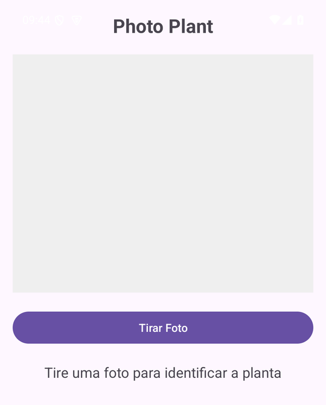

*Tela inicial do app em um emulador com Android 15, rodando um build com um `service_account.json` de mentira (`{}`). O print não mostra uma identificação: ela exige uma chave real do Google Cloud, que não foi usada aqui.*

O PhotoPlant é um app Android que tira a foto de uma planta e mostra o nome dela. Quem dá o nome é o modelo Gemini, do Google, chamado pela Vertex AI: a resposta vem em uma palavra, em português.

> **Este é um protótipo.** A chave da conta de serviço do Google Cloud vai empacotada dentro do APK, em `res/raw/service_account.json`. Isso serve para uma demonstração local e não serve para um app publicado, porque quem tiver o APK consegue tirar a chave de lá. Em produção, a chamada ao Gemini passaria por um backend ou pelo Firebase AI Logic com App Check, e nenhuma chave iria dentro do app. Os detalhes estão em [Limitações e segurança](#limitações-e-segurança).

> **Sobre o modelo.** O código de 2025 chamava o `gemini-2.0-flash`, que a [página de versões de modelos do Vertex AI](https://docs.cloud.google.com/vertex-ai/generative-ai/docs/learn/model-versions) lista como aposentado em 1º de junho de 2026. A constante `MODEL` agora aponta para o `gemini-3.5-flash-lite`, o substituto que a mesma página recomenda (consulta de 17/11/2026). **Essa troca não foi testada com uma chave real.** Além disso, a região `us-central1`, também fixa no código, não aparece na [página do modelo novo](https://docs.cloud.google.com/gemini-enterprise-agent-platform/models/gemini/3-5-flash-lite), que lista `global` e as multirregiões `us` e `eu` para o uso pago padrão. A chamada talvez precise de outro valor em `LOCATION`.

## Por que existe

O PhotoPlant foi um trabalho da faculdade, feito sozinho em 2025. O app não tem modelo próprio: manda a foto para um modelo de IA que entende imagens e pede o nome da planta em uma palavra.

## O que dá para fazer

- Tirar a foto de uma planta com o app de câmera do celular
- Ver a foto no quadro da tela principal
- Ler o nome que o Gemini devolve, ou a mensagem de erro se algo falhar

## Stack

- Java 11 e Android SDK 35, com mínimo no Android 7.0 (API 24)
- AndroidX (AppCompat, ConstraintLayout e Activity) e Material Components
- OkHttp 4.12.0 para chamar a API REST da Vertex AI
- `google-auth-library-oauth2-http` 1.34.0 para transformar a chave da conta de serviço em um token de acesso
- Gson 2.13.1 para montar o JSON do pedido e ler a resposta
- Gradle com Kotlin DSL e catálogo de versões (`gradle/libs.versions.toml`)

## Como funciona

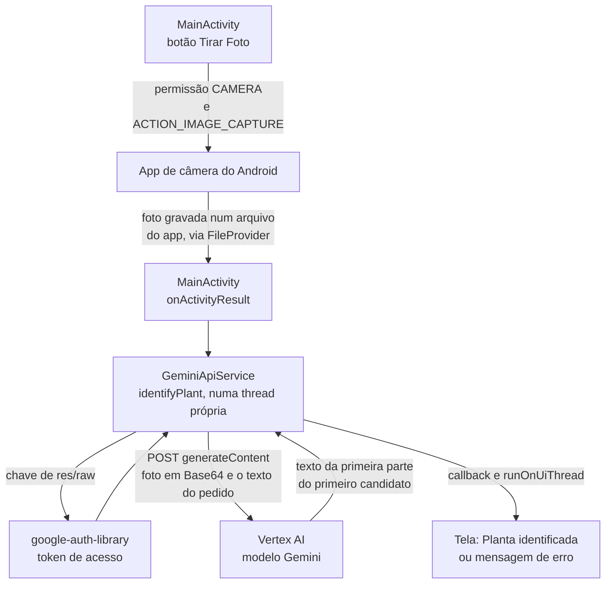

O botão **Tirar Foto** confere a permissão `CAMERA` e, com ela concedida, abre o app de câmera do sistema (`ACTION_IMAGE_CAPTURE`). A foto é gravada num arquivo de `getExternalFilesDir(Pictures)`, que o `FileProvider` compartilha com a câmera. Se nenhum app de câmera responder ao pedido, o botão não faz nada.

Quando a câmera devolve `RESULT_OK`, a `MainActivity` carrega a foto, mostra no quadro cinza e entrega o bitmap ao `GeminiApiService`, que trabalha numa thread própria. Ele pede à biblioteca de autenticação um token de acesso, comprime a foto em JPEG com qualidade 90, converte para Base64 e envia o pedido ao endpoint `generateContent` do modelo, com o token no cabeçalho `Authorization: Bearer`. O texto do pedido é `Identifique a planta da foto com apenas uma palavra em português.`

O app lê o texto da primeira parte do primeiro candidato da resposta e mostra `Planta identificada: <nome>`. Se a API responde com um status de erro, a tela mostra `Erro na API: <código> <mensagem>`, e qualquer exceção vira `Erro: <mensagem>`.

| Arquivo | O que faz |
|---|---|
| `MainActivity` | A única tela: pede a permissão da câmera, abre a câmera do sistema, mostra a foto e o resultado |
| `GeminiApiService` | Carrega a chave de `res/raw`, obtém o token, monta e envia o pedido ao Gemini e lê a resposta. O ID do projeto, a região e o modelo são constantes no topo da classe |
| `res/layout/activity_main.xml` | Título, quadro da foto, botão, texto do resultado e barra de progresso |
| `res/xml/file_paths.xml` | A pasta `Pictures` do app, que o `FileProvider` pode compartilhar com a câmera |

| Permissão | Para que o app usa |
|---|---|
| `INTERNET` | Chamar a API da Vertex AI e obter o token |
| `CAMERA` | Abrir a câmera do sistema; o app pede a permissão em tempo de execução. O manifesto também marca a câmera como obrigatória (`uses-feature`) |
| `WRITE_EXTERNAL_STORAGE` (até a API 28) | Está declarada, mas o código só grava em `getExternalFilesDir`, a pasta do próprio app |

## Decisões de projeto (e o que elas custam)

### 1. Chamada REST direta, sem o SDK do Firebase

O `GeminiApiService` monta o JSON à mão com Gson e envia com OkHttp. O caminho da foto até a resposta cabe numa classe de 169 linhas e o projeto tem poucas dependências. Em troca, o app cuida sozinho do token, do tempo limite (60 segundos) e do formato do pedido, e a leitura da resposta pega o primeiro `text` que achar, sem olhar o motivo de parada (`finishReason`).

### 2. Conta de serviço e token OAuth

O app autentica com uma conta de serviço do Google Cloud e manda um token de acesso no cabeçalho `Authorization: Bearer`. O JSON da conta fica em `res/raw`. Funciona numa demonstração local e é o ponto fraco do projeto, tratado em [Limitações e segurança](#limitações-e-segurança).

### 3. A câmera do sistema

O app não tem uma tela de câmera própria: abre a do sistema e recebe a foto num arquivo do próprio app, por um `FileProvider`. Isso poupa código de câmera. O app não controla a captura e envia a foto sem reduzir.

### 4. Um pedido que limita a resposta

O texto do pedido pede uma palavra em português. O app mostra o que vier, sem conferir se é mesmo o nome de uma planta.

## Como rodar

É preciso um projeto no Google Cloud com a Vertex AI ligada e uma conta de serviço com chave JSON. Sem esse JSON o app não compila: `GeminiApiService` e `MainActivity` usam `R.raw.service_account`, e um clone limpo falha com `cannot find symbol: variable raw` (conferido em 17/11/2026, com Gradle 8.11.1 e JDK 21). Com um `service_account.json` de mentira o build passa, mas isso só prova que compila, não que identifica planta.

Os prints abaixo são de maio de 2025, e o console do Google Cloud pode ter mudado desde então. IDs do projeto, e-mail da conta de serviço e nomes de aparelhos foram cobertos com tarjas.

### Etapa 1: Iniciando as configurações

1. **Crie uma conta Google** (se ainda não tiver):
   [https://accounts.google.com/signup](https://accounts.google.com/signup)

2. **Faça o cadastro de pagamento** no Google Cloud. O Vertex AI precisa de uma conta de faturamento:
   [https://console.cloud.google.com/freetrial/signup](https://console.cloud.google.com/freetrial/signup)

   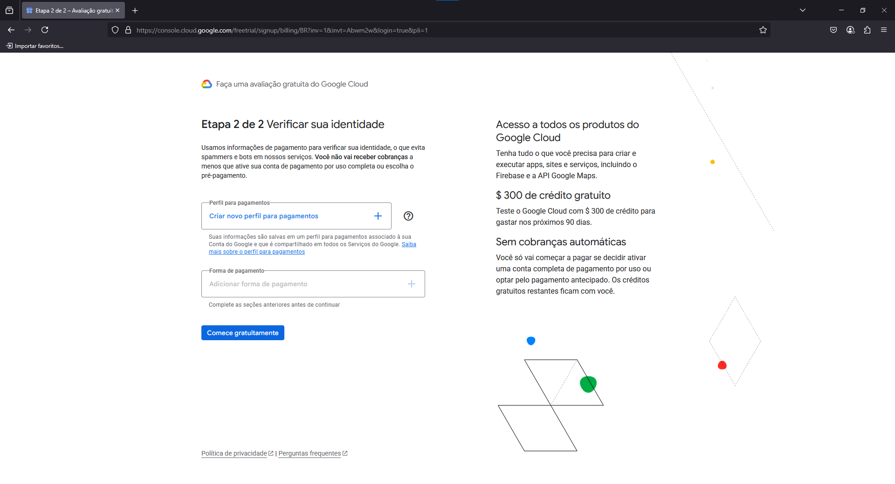

3. **Crie um novo projeto** no Google Cloud com o nome `Photo Plant`:
   [https://console.cloud.google.com](https://console.cloud.google.com)

   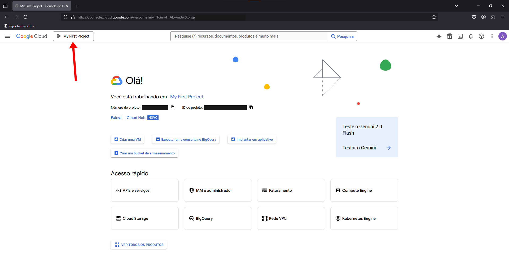
   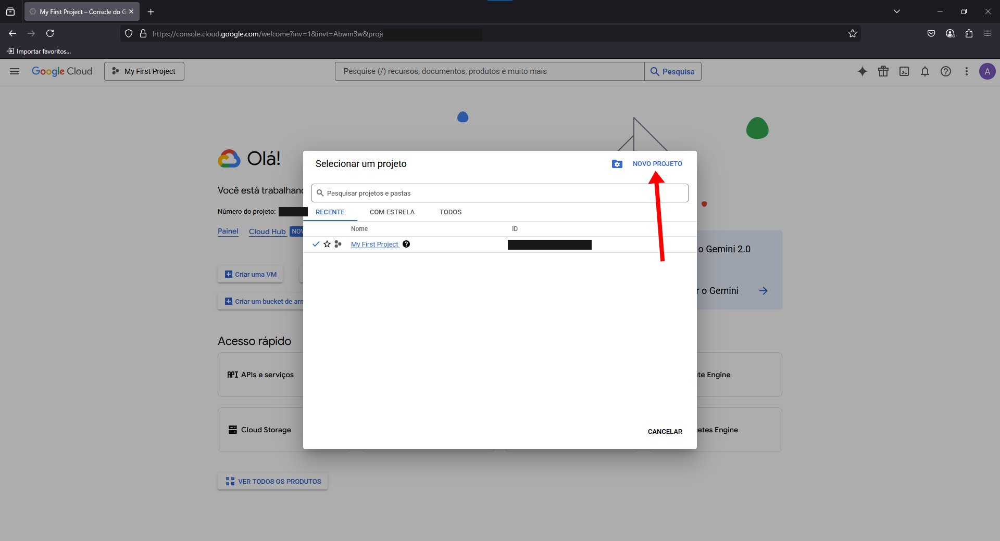
   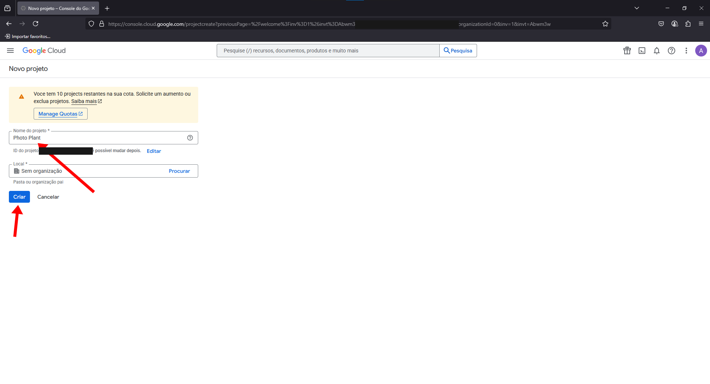

### Etapa 2: Habilitando a API da Vertex AI

1. Acesse o link abaixo para ativar a API:
   [Habilitar Vertex AI](https://console.cloud.google.com/flows/enableapi?apiid=aiplatform.googleapis.com&hl=pt-br)

   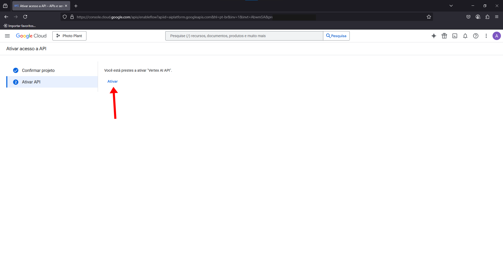

### Etapa 3: Criando a conta de serviço

1. Vá até [Contas de serviço](https://console.cloud.google.com/iam-admin/serviceaccounts).

2. Selecione o projeto criado.

   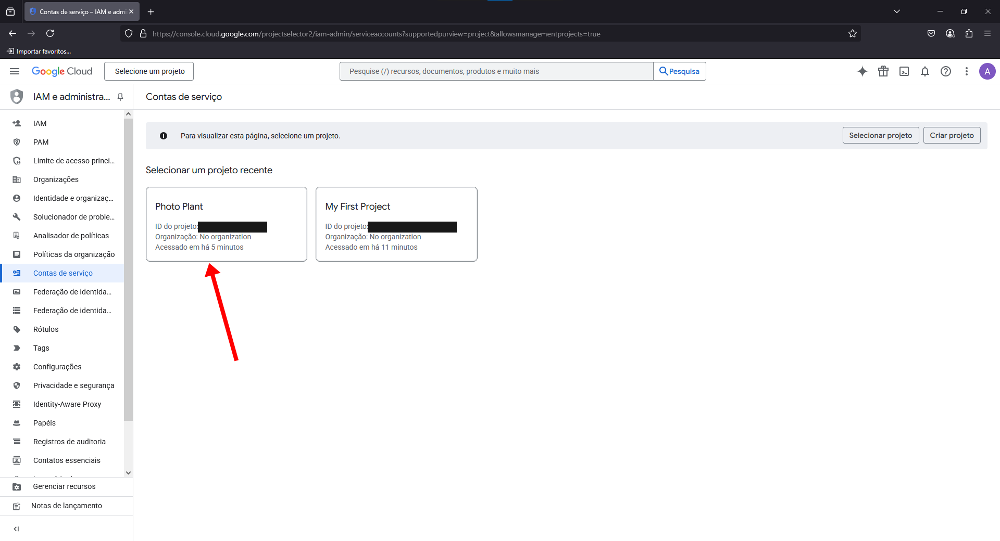

3. Clique em **Criar conta de serviço**.

   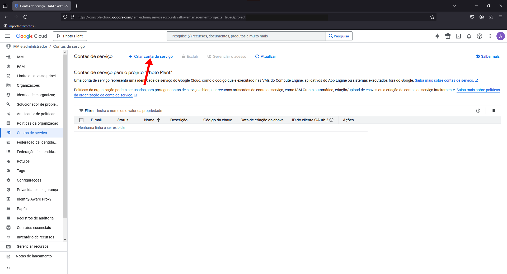

4. Na **Etapa 1, Detalhes da conta de serviço**, use o nome `vertex-ai-service`.

   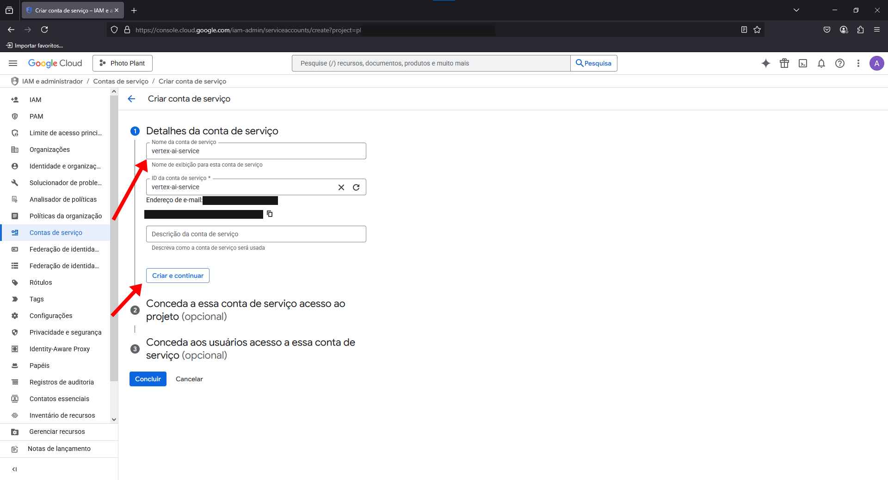

5. Na **Etapa 2, Acessos ao projeto**, adicione o papel `Usuário da Vertex AI`. O guia original de 2025 também adicionava `Criador do token da conta de serviço`, e o print mostra os dois. Não verifiquei se o app precisa do segundo; veja [Limitações e segurança](#limitações-e-segurança).

6. Ignore a Etapa 3 e clique em **Concluir**.

   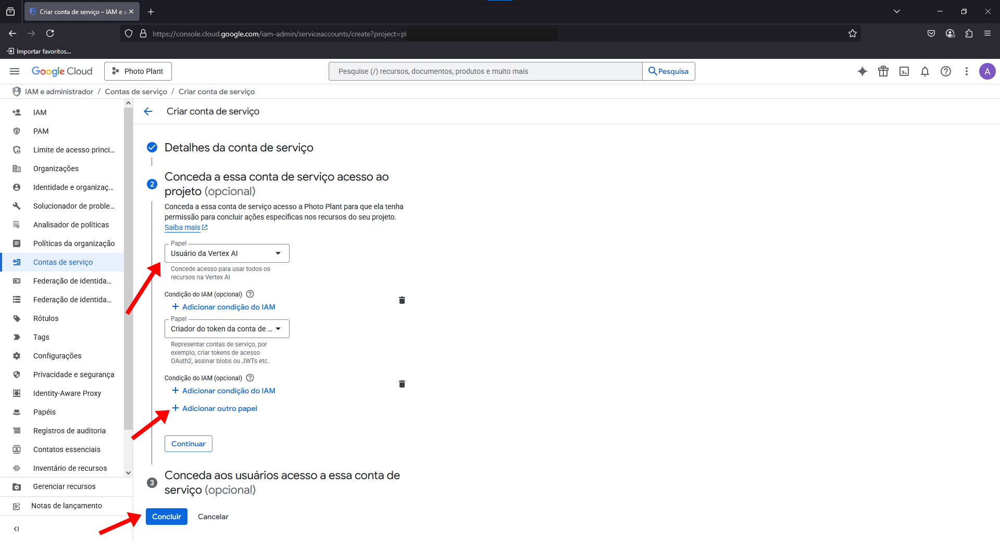

7. Depois de criada, clique no e-mail da conta de serviço.

   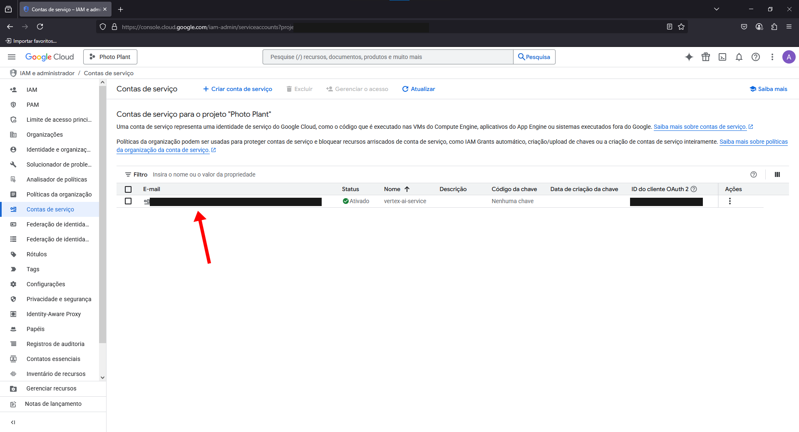

8. Vá até a aba **Chaves**, clique em **Adicionar chave** e depois em **Criar nova chave**.

   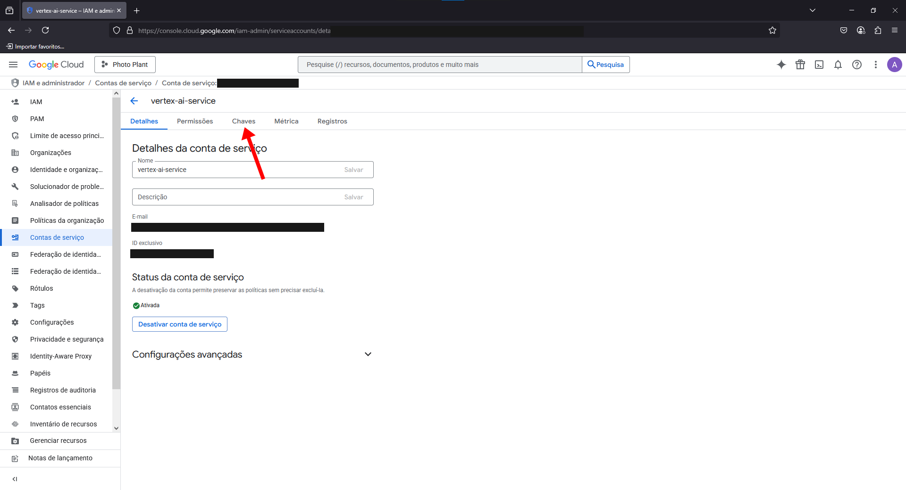
   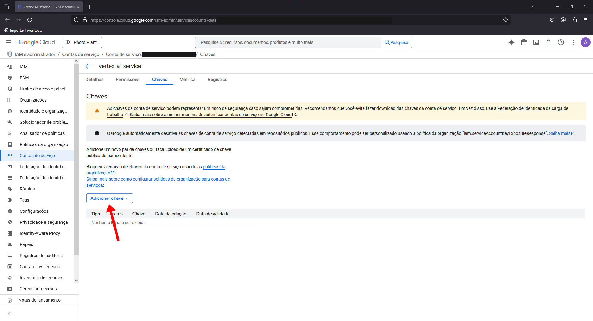

9. Escolha o tipo **JSON** e salve o arquivo.

   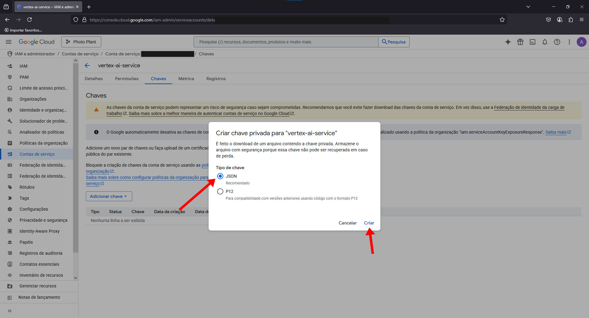

### Etapa 4: Colocando as credenciais no projeto Android

1. Acesse [https://console.cloud.google.com](https://console.cloud.google.com) e clique no projeto **Photo Plant**.

   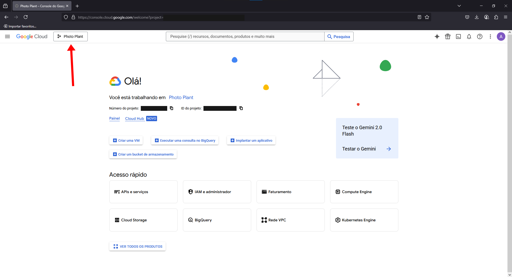

2. Copie o **ID do projeto**.

   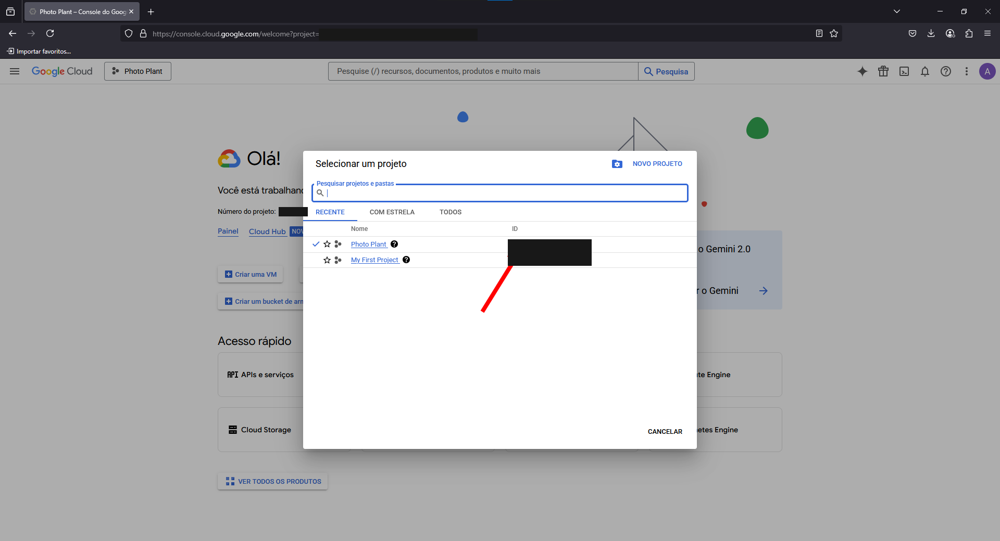

3. No Android Studio, abra o `GeminiApiService.java` e troque o valor de `PROJECT_ID`, hoje `ID_DO_PROJETO`, pelo ID copiado. O print mostra `gemini-2.0-flash`, o modelo de 2025.

   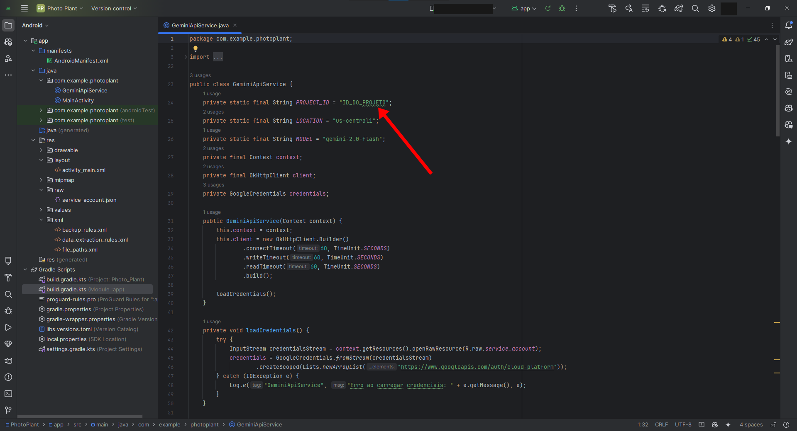

4. Renomeie o arquivo JSON baixado para `service_account.json` e coloque-o em `app\src\main\res\raw`.

   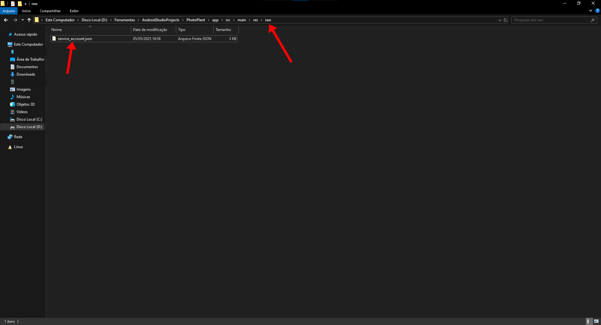

### Etapa 5: Rodando

Abra o projeto no Android Studio e rode o módulo `app` num aparelho com câmera, ou gere o APK com `gradlew.bat assembleDebug`. O `.gitignore` ignora `app/src/main/res/raw/service_account*`, então o JSON não entra no Git. Nunca o commite: o próprio console avisa que o Google desativa automaticamente chaves de conta de serviço detectadas em repositórios públicos.

## Limitações e segurança

- **A chave vai dentro do APK.** O JSON é um recurso do app, e o APK gerado guarda `res/raw/service_account.json` como um arquivo comum (conferido abrindo o APK de debug com `unzip`). Quem tiver o APK pode extrair a chave e usar a conta de serviço com os papéis dela, até a chave ser revogada, com a cobrança indo para o projeto do dono. O próprio console, no print [012](assets/012.png), diz que as chaves de conta de serviço "podem representar um risco de segurança caso sejam comprometidas" e recomenda evitar baixá-las.
- **O caminho para produção.** A chamada ao Gemini sairia do app. Uma opção é um backend próprio, que guarda a credencial e recebe a foto do app. A outra é o [Firebase AI Logic](https://firebase.google.com/docs/ai-logic), que a documentação descreve como um proxy entre o app e a API Gemini: com a Gemini Developer API, a chave fica no servidor e fora do código do app. O [App Check](https://firebase.google.com/docs/ai-logic/app-check) completa a proteção ao deixar passar só requisições verificadas como vindas do app de verdade, com Play Integrity ou reCAPTCHA Enterprise em produção. Nada disso está implementado aqui. A documentação do Firebase já chama a Vertex AI de "Agent Platform Gemini API (formerly Vertex AI)"; este README usa o nome do código e do console de 2025.
- **O modelo e a região não foram testados com chave real.** A troca para o `gemini-3.5-flash-lite` está descrita no topo. Na página do modelo, o uso pago padrão aparece em `global` e nas multirregiões `us` e `eu`, e `us-central1` não aparece pelo nome. Por isso a chamada talvez precise de outro valor em `LOCATION`, o que também não foi testado.
- **Um papel a mais, talvez.** O guia dá à conta de serviço o papel `Criador do token da conta de serviço`, que a documentação do IAM descreve como o que permite criar credenciais de curta duração para uma conta de serviço. A classe `ServiceAccountCredentials` da biblioteca de autenticação traz o fluxo em que a própria chave assina um JWT que vira token (ela contém `jwt-bearer` e `RS256`), então o papel pode ser desnecessário. Não testei sem ele; se for, o certo é tirá-lo.
- **A foto é enviada sem reduzir.** O app carrega o bitmap como veio da câmera e só o comprime em JPEG com qualidade 90, com tempo limite de 60 segundos.
- **Os erros da API chegam incompletos.** O `GeminiApiService` lê o corpo da resposta de erro e o descarta, então a tela mostra só o código e a mensagem HTTP. Se a chave não carregar, o `credentials` fica nulo e a falha só aparece depois da foto, como `Erro:` seguido da mensagem de uma `NullPointerException`.
- **Não há testes do app.** Só existem os dois do modelo do Android Studio: `2 + 2 == 4` e a conferência do nome do pacote.

## Próximos passos

- Tirar a chave do APK: backend próprio ou Firebase AI Logic com App Check
- Testar de ponta a ponta, com o modelo novo e a região, num aparelho e com uma chave própria
- Reduzir a foto antes de enviar
- Trocar o `startActivityForResult` pela Activity Result API e o `MediaStore.Images.Media.getBitmap` por uma leitura que não carregue a foto inteira: são os dois usos que o compilador marca como obsoletos (`-Xlint:deprecation`)
- Mostrar o corpo do erro da API e falhar cedo quando a chave não carregar, em vez de deixar o `credentials` nulo
- Tirar o `inicializarCredenciais` da `MainActivity`, que carrega as credenciais só para descartar o resultado, e tirar o ID do projeto, a região e o modelo do código
- Separar a montagem do pedido e a leitura da resposta em classes sem Android e testá-las
- Conferir se o papel `Criador do token da conta de serviço` faz falta

## Licença

MIT. Veja o arquivo [LICENSE](LICENSE).
